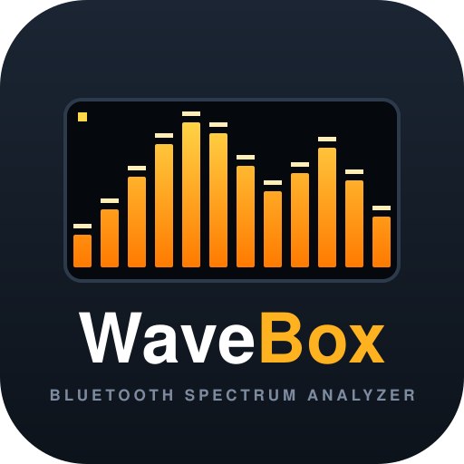

<p align="center">
  
</p>

# WaveBox

> **Attenzione: questa versione non funziona ancora.** Il firmware di questo branch non è stato compilato né provato sulla scheda e probabilmente richiede correzioni agli include. Dettagli in [docs/tentativo_04.md](docs/tentativo_04.md).

Ricevitore audio Bluetooth basato su ESP32 Audio Kit con codec ES8388.

L'ESP32 si presenta come cassa Bluetooth (A2DP sink) e passa il flusso audio ad `AudioKitStream` (arduino-audio-tools + arduino-audiokit), che configura il codec ES8388 e l'I2S della scheda.

L'analizzatore di spettro su display OLED SSD1322 delle versioni precedenti non è presente in questo branch.

## Funzionalità

- Ricezione audio Bluetooth A2DP, nome dispositivo **`ESP32_AUDIO_KIT`**
- Uscita audio sul codec ES8388 tramite `AudioKitStream`, volume iniziale 70
- Gestione dei tasti della scheda tramite `kit.processActions()`
- Log di arduino-audio-tools sulla seriale

## Hardware

- Scheda ESP32 Audio Kit (A1S) con codec ES8388 (`esp32dev` in PlatformIO)

I pin di I2S e I2C non sono definiti in `src/main.cpp`: li sceglie arduino-audiokit in base alla scheda configurata con la macro `AUDIOKIT_BOARD`.

## Compilazione e caricamento

Il progetto usa [PlatformIO](https://platformio.org/) (framework Arduino).

```bash
pio run                      # compila
pio run -t upload            # carica sulla scheda
pio device monitor           # monitor seriale (115200 baud)
```

Dopo l'avvio, abbinare il telefono o il PC al dispositivo Bluetooth `ESP32_AUDIO_KIT` e avviare la riproduzione.

## Architettura

Tutto il codice applicativo è in `src/main.cpp`:

1. **AudioKit**: `AudioKitStream` viene configurato in `TX_MODE` e inizializza codec e I2S.
2. **Bluetooth A2DP**: `BluetoothA2DPSink` riceve il flusso PCM e lo passa alla callback `read_data_stream()`, che lo scrive su `AudioKitStream`. Il sink non usa la propria uscita I2S.
3. **`loop()`**: chiama `kit.processActions()`.

## Librerie

- [ESP32-A2DP](https://github.com/pschatzmann/ESP32-A2DP): Bluetooth audio
- [arduino-audio-tools](https://github.com/pschatzmann/arduino-audio-tools): `AudioKitStream` e logging
- [arduino-audiokit](https://github.com/pschatzmann/arduino-audiokit): driver del codec e pin della scheda

Le tre librerie sono in `lib_deps` e vengono scaricate da git senza una versione fissata. In `lib/` è inclusa una copia locale di ESP32-A2DP (1.8.8), che ha la precedenza su quella di `lib_deps`.

## Documentazione

- [docs/tentativo_04.md](docs/tentativo_04.md): modifiche attuali del branch `tentativo_03` (AudioKitStream)
- [docs/tentativo_03.md](docs/tentativo_03.md): primo `tentativo_03` (init manuale dell'ES8388), unito in `main` con la PR #2
- [docs/tentativo_02.md](docs/tentativo_02.md): modifiche del branch `tentativo_02` (le librerie in `src/libraries/` descritte lì sono state rimosse in seguito)
